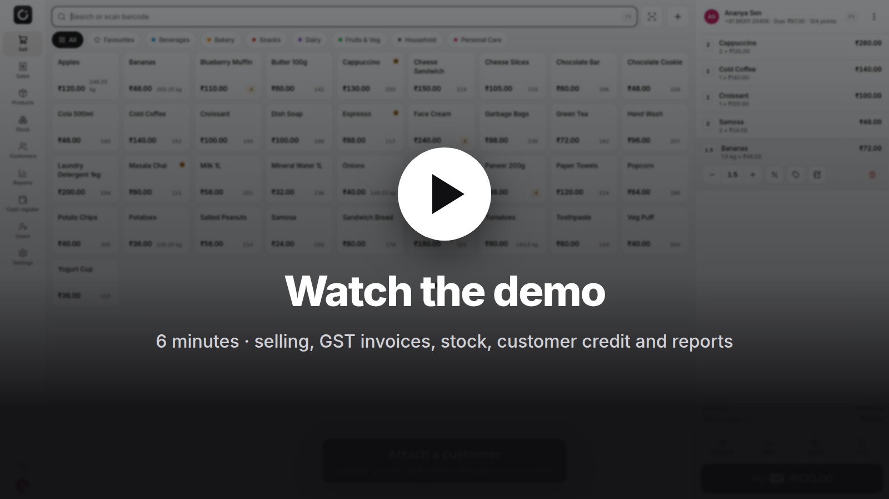

<p align="center"></p>

<h1 align="center">OpenPOS</h1>

<p align="center">
Fast, offline-first point of sale for shops, supermarkets, cafés, restaurants and service businesses.<br>
One codebase → <b>Web (PWA) · Windows · macOS · Linux · Android · iOS</b> — phones, tablets and PCs.
</p>

<p align="center"><b><a href="https://imbikramsaha.github.io/openpos/">Website</a></b> · <a href="#download">Download</a> · <a href="https://appkasapos.netlify.app">Web app</a></p>

<p align="center">
<a href="https://github.com/imbikramsaha/openpos/releases/latest/download/OpenPOS-Setup-x64.exe"></a>
<a href="https://github.com/imbikramsaha/openpos/releases/latest/download/OpenPOS-mac-universal.dmg"></a>
<a href="https://github.com/imbikramsaha/openpos/releases/latest/download/openpos-linux-amd64.deb"></a>
<a href="https://github.com/imbikramsaha/openpos/releases/latest/download/OpenPOS-android.apk"></a>
<a href="https://appkasapos.netlify.app"></a>
<a href="https://appkasapos.netlify.app"></a>
</p>

<p align="center"><a href="https://imbikramsaha.github.io/openpos/#demo"></a></p>
<p align="center"><a href="https://imbikramsaha.github.io/openpos/#demo">▶ Watch the 6-minute demo</a> · <a href="https://github.com/imbikramsaha/openpos/releases/download/v1.2.0/OpenPOS-demo-4K.mp4">Download it in 4K</a></p>

---

## Download

Every link below downloads the newest version. Older versions are on the [releases page](https://github.com/imbikramsaha/openpos/releases).

| Device | Download |
|---|---|
| **Windows** 10 and 11 | [Installer (.exe)](https://github.com/imbikramsaha/openpos/releases/latest/download/OpenPOS-Setup-x64.exe) · [Portable, no install needed](https://github.com/imbikramsaha/openpos/releases/latest/download/OpenPOS-Portable-x64.exe) |
| **Mac**, Apple Silicon and Intel | [OpenPOS-mac-universal.dmg](https://github.com/imbikramsaha/openpos/releases/latest/download/OpenPOS-mac-universal.dmg) |
| **Linux**: Ubuntu, Debian, Mint, Pop!_OS | [.deb](https://github.com/imbikramsaha/openpos/releases/latest/download/openpos-linux-amd64.deb) |
| **Linux**: any distribution | [AppImage](https://github.com/imbikramsaha/openpos/releases/latest/download/OpenPOS-linux-x86_64.AppImage) |
| **Linux ARM**: Raspberry Pi 4 and 5 | [.deb](https://github.com/imbikramsaha/openpos/releases/latest/download/openpos-linux-arm64.deb) · [AppImage](https://github.com/imbikramsaha/openpos/releases/latest/download/OpenPOS-linux-arm64.AppImage) |
| **Android** phones and tablets (Android 7 or newer) | [OpenPOS-android.apk](https://github.com/imbikramsaha/openpos/releases/latest/download/OpenPOS-android.apk) |
| **iPhone and iPad** | Open **https://appkasapos.netlify.app** in Safari, tap **Share**, then **Add to Home Screen** |
| **Any device with a browser** (Chromebook, shared PCs) | **https://appkasapos.netlify.app**, then the **Install app** button (⬇) at the top |

### First launch

The installers aren't code-signed yet, so each system asks once whether you trust the app:

- **Windows**: if you see "Windows protected your PC", click **More info**, then **Run anyway**.
- **Mac**: open the `.dmg` and drag **OpenPOS** into **Applications**, then open it. When macOS says it can't verify the developer, click **Done**, go to **System Settings → Privacy & Security**, scroll down and click **Open Anyway**. After that it opens normally.
- **Linux**: double-click the `.deb` to install it in your software centre, or run `sudo apt install ./openpos-linux-amd64.deb`. For the AppImage, right-click it → **Properties** → allow it to run as a program, then double-click it.
- **Android**: open the downloaded APK. If asked, allow your browser to **install unknown apps**, then tap **Install**. If Play Protect warns about an unknown app, tap **More details → Install anyway**.
- **iPhone and iPad**: after **Add to Home Screen**, OpenPOS opens from its icon full screen and works offline. An App Store version needs an Apple Developer account, see [docs/DEPLOYMENT.md](docs/DEPLOYMENT.md#5-ios--ipados).

The Windows and Linux apps update themselves. The web app always runs the latest version.

---

## Why OpenPOS

- **Works offline, always.** Every till keeps a full local database. Internet down? Keep selling. Changes sync automatically when you're back online.
- **Runs everywhere.** Install it from the browser, or use native desktop and mobile apps built from the same code.
- **Fast at the counter.** Barcode scanners work anywhere on the sell screen, there are keyboard shortcuts for everything, tiles are touch-friendly, and paying is a tap on the method, then **Complete sale** (or Enter, Enter).
- **Speaks your customers' language.** 34 languages: 13 Indian languages, 20 major world languages and English. Urdu, Arabic and Persian get full right-to-left layout.
- **Built for India, ready for the world.** GST invoices with CGST/SGST/IGST and HSN codes, a UPI QR with the amount pre-filled, credit ledgers (khata), and lakh/crore formatting. Country presets cover 38 countries' currencies and tax rates.

## Features

### Selling
- Product grid with categories and favourites, instant search, and USB/Bluetooth barcode scanners (keyboard mode).
- **Camera barcode scanning** on phones and tablets, works offline.
- **Weighing-scale barcodes** carrying embedded weight or price, plus sold-by-weight and open-price items.
- Quantity, price override, line and whole-sale discounts (percent or amount), item and sale notes.
- **Hold / recall** sales to serve the next customer; custom one-off items.
- **Split payments:** cash with quick-cash buttons and change, card, **UPI QR**, **on account (khata)** with credit limits, loyalty points, bank transfer, vouchers.
- Customers attached in two taps, with automatic customer discounts and loyalty earning.
- Returns with or without the original receipt, refunds with restock control, and voids behind manager approval. A mistake spotted right after a sale? **Back to edit** on the receipt voids it and puts the items back in the cart.
- **Customer-facing display** for a second screen, showing items, total, the UPI QR and change due.
- Keyboard shortcuts (F1 shows them all), and the cart survives crashes and reloads.

### Receipts & invoices
- Thermal receipts (58/80 mm) and **A4 GST tax invoices**: HSN, CGST/SGST/IGST split, place of supply, amount in words.
- Print (silent printing on desktop, or save as PDF from the print dialog), WhatsApp, share sheet or email.
- Logo, header and footer; receipt barcode for fast refund lookup; credit notes for refunds.

### Back office
- **Products:** categories, images, colours, SKU/barcode (auto-generate EAN-13), HSN, MRP, cost and margin, CSV import/export, **barcode label printing**, bulk edit.
- **Inventory:** real-time stock ledger, adjustments with reasons, stock-take, low-stock alerts, **purchases from suppliers**, stock valuation.
- **Customers:** purchase history, credit balance and statements, receiving payments, WhatsApp payment reminders, loyalty points.
- **Sales history:** filters, receipt reprint, refunds, voids, CSV export.
- **Reports:** dashboard, sales trends, hourly sales, payment methods, top products, categories, staff performance, profit and margin, **GST/tax reports (HSN summary, B2B/B2C)**, customer dues, inventory valuation. All reports export to CSV and print.
- **Cash register:** open and close shifts, cash in/out, cash counting by denomination, over/short, X and Z reports.
- **Users & roles:** admin, manager and cashier with fine-grained permissions, PIN login, **manager override** prompts, auto-lock, audit log.
- **Settings:** business profile, taxes, currency and formats, payment methods, receipt designer with live preview, loyalty, scale barcodes, per-device printer, language and theme.
- **Backup & restore** to a single file, **automatic backups** on a schedule and after each shift to this device or a folder (optionally encrypted), plus optional **multi-terminal sync** through a self-hosted server (LAN or cloud).

### Coming soon

These are partly built and show **Coming soon** in the app until they're finished:

- **Restaurant mode:** dine-in, takeaway and delivery orders with table numbers.
- **Cloud backups** straight to Google Drive, OneDrive and Dropbox. Until then, point the folder backup at your Drive, OneDrive or Dropbox folder on a desktop.
- **Printing and saving files in the Android app** (receipts, reports, CSV exports and backup files). Until then, print and export from the desktop or web app.
- **Paying suppliers later:** recording payments against a purchase that wasn't paid in full.

### Quality
- Light and dark themes, a responsive layout from 360 px phones to large desktops, and touch-first controls.
- Money is stored in integer minor units (no floating-point errors). Tax maths is covered by unit tests.
- Sales, stock and credit are append-only ledgers, so concurrent terminals never overwrite each other.

## Quick start

```bash
npm install
npm run dev            # http://localhost:5173 — first run opens the setup wizard
```

The wizard sets your language, country (currency and tax preset), business details and admin PIN, and can load sample products.

| Task | Command |
|---|---|
| Type-check, unit tests, i18n check | `npm run typecheck` · `npm test` · `npm run i18n:check -- --all` |
| Production web build (PWA) | `npm run build` → `dist/` (host on any static server over HTTPS) |
| End-to-end smoke test (system Chrome) | `npm run dev` then `npm run e2e` |
| Desktop app (dev) | `npm run dev` + `npm run desktop:dev` |
| Desktop installers | `npm run dist:win` · `npm run dist:mac` · `npm run dist:linux` |
| Android / iOS | `npm run android` · `npm run ios` (opens Android Studio / Xcode) |
| Sync server | `npm run server` (see [`server/README.md`](server/README.md)) |

Releases (`npm run release -- 1.2.3`) build the Windows, Mac, Linux and Android installers in GitHub Actions and publish them as a GitHub Release, which the [Download](#download) links always point to. See [`docs/DEPLOYMENT.md`](docs/DEPLOYMENT.md#releases-and-auto-update).

## Hardware

- **Barcode scanners:** any USB or Bluetooth scanner in keyboard (HID) mode. No setup; scan anywhere on the sell screen.
- **Receipt printers:** any 58/80 mm thermal printer with a system driver. Desktop builds can print silently to a chosen printer.
- **Cash drawers:** RJ11 drawers connected to the receipt printer, opened from the Sell menu (desktop app).
- **Weighing scales:** EAN-13 labels with embedded weight or price. Configure the prefix and digits in Settings.
- **Customer display:** any second monitor, via Sell menu → Customer display.

## Languages

English · हिन्दी · বাংলা · తెలుగు · मराठी · தமிழ் · اردو · ગુજરાતી · ಕನ್ನಡ · മലയാളം · ଓଡ଼ିଆ · ਪੰਜਾਬੀ · অসমীয়া · नेपाली ·
Español · Français · Deutsch · Português · Italiano · Nederlands · Polski · Русский · Türkçe · العربية · فارسی ·
简体中文 · 日本語 · 한국어 · Bahasa Indonesia · Bahasa Melayu · Tiếng Việt · ไทย · Filipino · Kiswahili

Each terminal picks its own language; receipts print in the terminal's language. Translations live in
`src/i18n/locales/<code>/*.json`. English is the source, and `npm run i18n:check -- --all` verifies every language.

## Architecture

React 19 + TypeScript + Vite + Tailwind CSS, Dexie (IndexedDB) for local storage, Zustand for state, and i18next.
Electron handles desktop builds and Capacitor handles Android and iOS. The sync server uses Node + SQLite with zero dependencies.
See [`docs/ARCHITECTURE.md`](docs/ARCHITECTURE.md) for data rules, conventions and the sync protocol.

## Roadmap

Planned next, contributions welcome:
- Product variants (size and colour matrix), batch/expiry and serial/IMEI tracking.
- Promotions engine (buy X get Y, happy hours, price lists, customer groups), gift-card balances.
- Restaurant kitchen order tickets (KOT), table map, modifiers and split bills.
- Payment terminal integrations (Razorpay/Pine Labs POS, Stripe Terminal, SumUp) and automatic UPI payment confirmation.
- India e-invoicing (IRN/QR) and e-way bills, and GSTR-1 JSON export.
- Accounting exports (Tally, Zoho Books, QuickBooks, Xero) and e-commerce sync (Shopify, WooCommerce).
- WhatsApp Business API and SMS receipts sent automatically.
- Multi-branch head-office dashboard and stock transfers between stores.

## License

[MIT](LICENSE) © 2026 Bikram Saha
